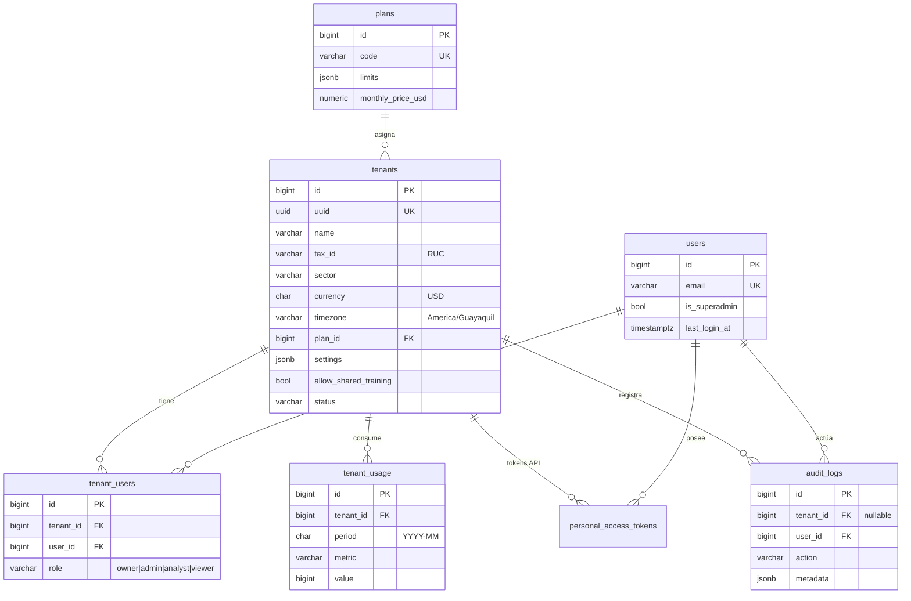
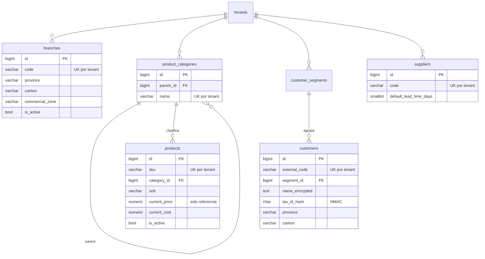
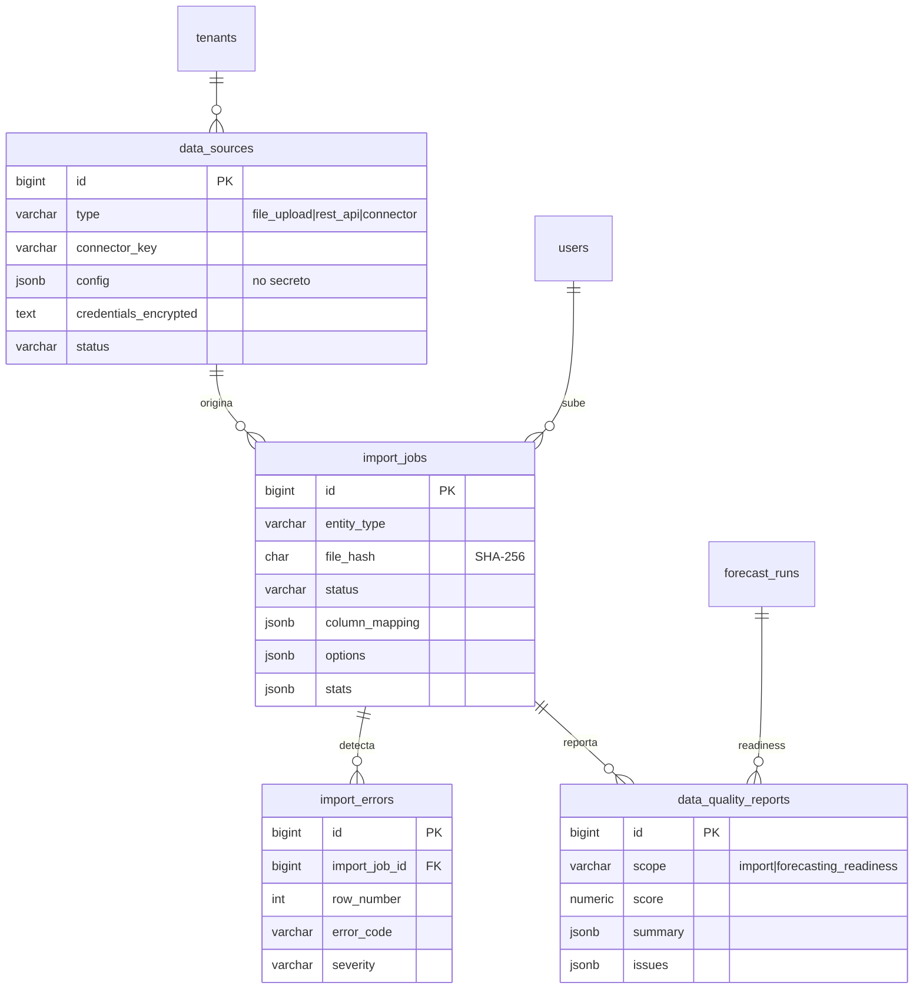
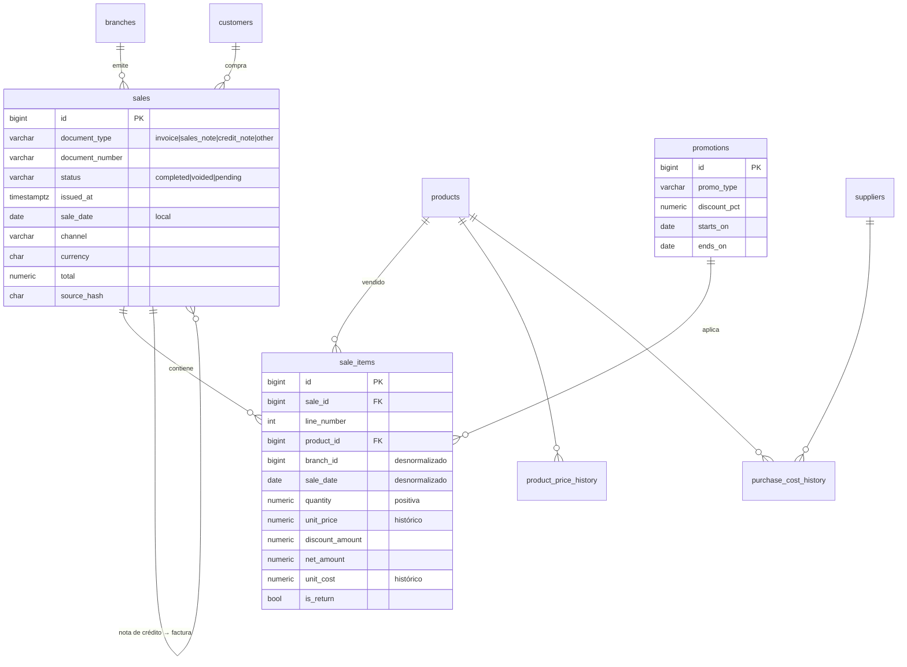
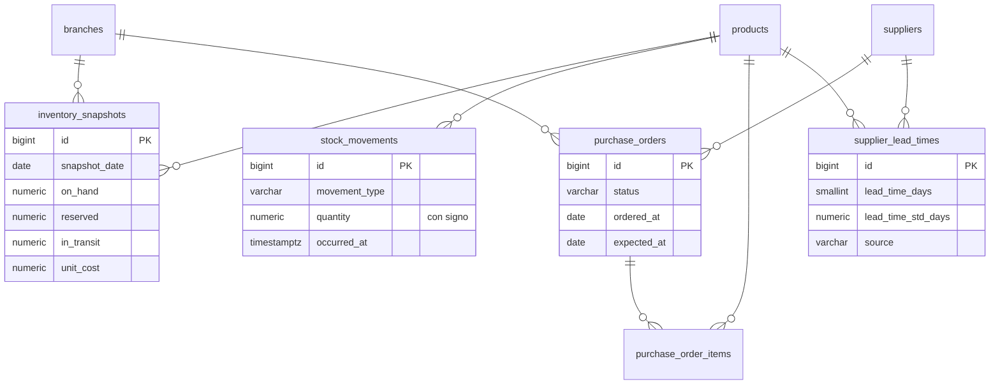
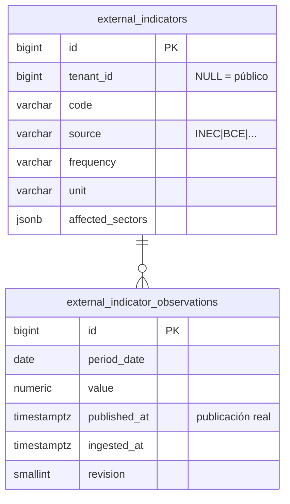
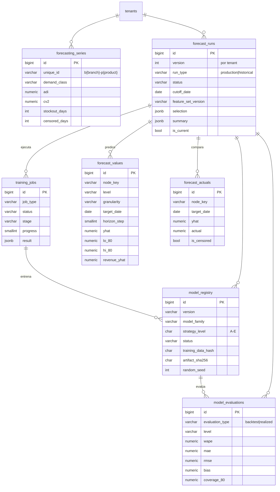

# 03 · Modelo de datos

Fuente de verdad: migraciones en `backend/database/migrations/` (PostgreSQL 16). Este documento
las resume; ante cualquier diferencia, mandan las migraciones.

## Convenciones globales

- **PK** `id` bigint autoincremental en todas las tablas. La empresa se expone por `tenants.uuid`
  (header `X-Tenant-ID`), nunca por su id numérico.
- **Control de tenant**: toda tabla de negocio tiene `tenant_id NOT NULL` con FK a `tenants`
  (`ON DELETE CASCADE`, usado solo por la purga definitiva). Excepciones explícitas con
  `tenant_id` nulo = dato de plataforma: `external_indicators`, `forecast_features`,
  `model_registry` (modelos globales/sectoriales), `audit_logs` (eventos sin empresa),
  `personal_access_tokens`.
- **FKs compuestas por tenant**: las tablas referenciadas exponen `UNIQUE (tenant_id, id)` y las
  referencias usan `FOREIGN KEY (tenant_id, x_id) REFERENCES x (tenant_id, id)`. La base de datos
  rechaza, por sí misma, una venta de la Empresa A que apunte a un producto o sucursal de la B.
- **Tiempo**: `timestamptz` (UTC) para eventos; `date` local de la empresa para agregaciones
  (`sales.sale_date`, `sale_items.sale_date`). Montos y cantidades `numeric(14,4)`.
- **Valores enumerados** como `varchar` validado por enums de PHP (sin `CHECK` en BD, para evolucionar
  sin migraciones costosas). Los valores permitidos figuran en los comentarios de columna.
- **Borrado lógico** (`deleted_at`) en catálogos y entidades editables (users, tenants, branches,
  products, customers, suppliers, data_sources). Datos transaccionales y resultados del motor no
  se borran lógicamente: se versionan o se purgan por retención.
- **Índices**: solo los justificados por consultas esperadas (ver cada tabla). Las PK y UNIQUE ya
  crean índice; no se duplican.

---

## 1. Plataforma y multi-tenancy

| Tabla | Propósito | Campos clave | Índices (consulta que justifican) | Integridad / auditoría |
|---|---|---|---|---|
| `plans` | Planes SaaS con límites | `code` UK, `limits` jsonb (`max_branches`, `max_active_products`, `max_import_rows_per_month`, `max_forecast_runs_per_day`, `max_users`, `horizons`, `features`) | `code` UK (asignación por código) | Asignación manual por superadmin |
| `tenants` | Empresa cliente, raíz del aislamiento | `uuid` UK, `sector`, `currency`, `timezone`, `plan_id`, `plan_overrides`, `settings` (horizonte, nivel de servicio, revisión, plazo por defecto, frecuencia), `allow_shared_training` + fecha/usuario de consentimiento, `data_retention_months` (60), `status` (active/suspended/pending_deletion), `deletion_requested_at` | `uuid` UK (resolución por header); `status` (jobs programados recorren empresas activas) | Soft delete; consentimiento con fecha y autor |
| `users` | Personas usuarias | `email` UK, `is_superadmin`, `locale`, `last_login_at` | `email` UK (login) | Soft delete; el superadmin no lee datos de negocio |
| `tenant_users` | Membresía y rol | `role` | UK `(tenant_id, user_id)` (verificación de membresía); `user_id` ("mis empresas") | Cascada al borrar empresa o usuario; cambios de rol auditados |
| `tenant_usage` | Consumo mensual por métrica | `period`, `metric`, `value` | UK `(tenant_id, period, metric)` (upsert de contadores) | — |
| `personal_access_tokens` | Tokens Sanctum; `tenant_id` liga tokens de integración a una empresa | `token` (hash) UK, `abilities`, `expires_at` | `token` UK; `expires_at` (limpieza) | El token con `tenant_id` ignora el header `X-Tenant-ID` |
| `audit_logs` | Bitácora de solo inserción | `action`, `auditable_type/id`, `ip_address`, `user_agent`, `metadata` (sin PII) | `(tenant_id, created_at)` (consulta por empresa); `(user_id, created_at)` (actividad de un usuario); `(action, created_at)` (seguridad: logins fallidos) | Sin `updated_at`; retención propia (ver docs/07) |

Tablas de infraestructura de Laravel: `sessions`, `password_reset_tokens`, `cache`, `cache_locks`,
`jobs`, `job_batches`, `failed_jobs` (las colas productivas usan Redis).

---

## 2. Catálogos de la empresa

| Tabla | Propósito | Campos clave | Índices | Integridad |
|---|---|---|---|---|
| `branches` | Sucursales/establecimientos | `code` (p. ej. `001` del SRI), ubicación agregada (provincia, cantón, zona), `opening_hours` | UK `(tenant_id, code)` (resolver `branch_code` al importar); UK `(tenant_id, id)` (destino de FKs compuestas) | Soft delete; `RESTRICT` desde ventas (una sucursal con ventas se desactiva, no se borra) |
| `product_categories` | Jerarquía de categorías | `parent_id` (FK compuesta a sí misma) | UK `(tenant_id, name)` (crear/resolver categoría al importar) | `parent` en `SET NULL` |
| `products` | Productos | `sku`, `unit`, `brand`, `current_price/cost` (referencia actual — **no** se usa para reconstruir el pasado), `attributes` jsonb | UK `(tenant_id, sku)` (resolver SKU al importar); `(tenant_id, category_id)` (filtros por categoría) | Soft delete; `RESTRICT` desde líneas de venta |
| `customer_segments` | Segmentos comerciales | `code`, `name` | UK `(tenant_id, code)` | — |
| `customers` | Clientes con **minimización LOPDP** | `external_code`, `customer_type`, `name_encrypted` (cifrado con APP_KEY), `tax_id_hash` (HMAC de cédula/RUC, nunca en claro), ubicación agregada | UK `(tenant_id, external_code)` (resolver al importar); `(tenant_id, segment_id)` (análisis por segmento) | Soft delete; dirección exacta no requerida |
| `suppliers` | Proveedores | `code`, `tax_id`, `default_lead_time_days` | UK `(tenant_id, code)` | Soft delete |

---

## 3. Ingesta y calidad de datos

| Tabla | Propósito | Campos clave | Índices | Integridad / trazabilidad |
|---|---|---|---|---|
| `data_sources` | Origen de datos (archivo, REST, conector) | `type`, `connector_key`, `config` (no secreto), `credentials_encrypted` (nunca se devuelve por API), `status`, `last_synced_at`, `last_error` | UK `(tenant_id, id)`; `(tenant_id, type)` (listar por tipo) | Soft delete |
| `import_jobs` | Ciclo de vida de una importación | `entity_type`, `stored_path` (`tenants/{id}/imports/...`), `file_hash`, `status` (uploaded → awaiting_mapping → validating → validated → importing → completed / failed / rejected), `detected_columns`, `suggested_mapping`, `column_mapping`, `options`, `preview`, `stats`, `progress` | `(tenant_id, created_at)` (historial); `(tenant_id, file_hash)` (detectar re-subida del mismo archivo) | Conserva archivo original y hash; `sales.import_job_id` apunta al último import que tocó cada documento |
| `import_errors` | Errores/advertencias por fila | `row_number`, `column`, `error_code`, `severity`, `raw_value` (truncado, sin PII completa) | `(import_job_id, severity, row_number)` (paginación de errores filtrada) | Cascada con el import |
| `data_quality_reports` | Reporte de calidad de una importación o de aptitud para pronóstico | `scope`, `score` (0–100, orientativo), `summary`, `issues` | `(tenant_id, scope, created_at)` (último reporte por tipo) | FKs compuestas a import y a ejecución |

---

## 4. Ventas, precios, costos y promociones

| Tabla | Propósito | Campos clave | Índices (consulta) | Reglas de integridad |
|---|---|---|---|---|
| `sales` | Cabecera de documento comercial | `document_type`, `document_number` (p. ej. `001-001-000012345`), `status`, `issued_at`, `sale_date` (fecha local de la empresa), `channel`, `currency`, totales, `related_sale_id` (nota de crédito → factura), `source_hash` (hash del contenido normalizado), `import_job_id`, `data_source_id` | **UK `(tenant_id, document_type, document_number)`** = clave de idempotencia; `(tenant_id, sale_date)` (resúmenes por período); `(tenant_id, branch_id, sale_date)` (resumen por sucursal); `(tenant_id, customer_id)` (historial de cliente) | Reimportar: mismo hash → sin cambios; hash distinto → actualiza cabecera y reemplaza líneas; nunca duplica |
| `sale_items` | Líneas con condiciones **históricas** | `quantity` (siempre positiva), `unit_price` (precio original antes de descuento), `discount_amount`, `net_amount` (sin impuestos), `tax_amount`, `unit_cost` (si el origen lo provee), `is_return`, `promotion_id`; `branch_id` y `sale_date` desnormalizados | UK `(sale_id, line_number)`; **`(tenant_id, sale_date, branch_id, product_id)`** → consulta principal del motor (series diarias); **`(tenant_id, product_id, sale_date)`** → histórico de un producto en el dashboard | FKs compuestas a venta, producto, sucursal y promoción. Las devoluciones no se restan de la demanda diaria: se reportan aparte |
| `promotions` | Promociones planificadas o históricas (variables conocidas a futuro) | `promo_type`, `discount_pct`, `starts_on`, `ends_on`, alcance por sucursal/producto/categoría (NULL = todos) | `(tenant_id, starts_on, ends_on)` (promociones vigentes en una fecha) | — |
| `product_price_history` | Historial de precios de lista | `price`, `valid_from`, `valid_to`, `branch_id` (NULL = general), `source` | `(tenant_id, product_id, valid_from)` (precio vigente en fecha) | Solo inserción |
| `purchase_cost_history` | Historial de costos de compra | `unit_cost`, `supplier_id`, `valid_from`, `purchase_order_id`, `source` | `(tenant_id, product_id, valid_from)` (costo vigente en fecha) | Solo inserción |

**Regla de negocio:** nunca se reconstruyen condiciones comerciales pasadas con `products.current_price`;
el precio histórico vive en `sale_items` y en `product_price_history`.

---

## 5. Inventario y abastecimiento

| Tabla | Propósito | Índices (consulta) | Notas |
|---|---|---|---|
| `inventory_snapshots` | Existencias al cierre del día | UK `(tenant_id, branch_id, product_id, snapshot_date)` (upsert idempotente y lookup por serie); `(tenant_id, snapshot_date)` (último inventario de la empresa, días sin stock) | Base para detectar **ventas censuradas** (stock ≤ 0) |
| `stock_movements` | Entradas/salidas con signo | `(tenant_id, product_id, occurred_at)` | F4: reconstrucción de inventario diario |
| `purchase_orders` / `purchase_order_items` | Compras y cantidades en tránsito | `(tenant_id, status)` (órdenes abiertas); `(tenant_id, product_id)` (en tránsito por producto) | Predictily no crea pedidos automáticamente |
| `supplier_lead_times` | Plazos de entrega | `(tenant_id, product_id)` | Resolución: producto+sucursal > producto > proveedor > `settings.default_lead_time_days` |

---

## 6. Indicadores externos

- `external_indicators`: UK `(tenant_id, code)` + índice único parcial `(code) WHERE tenant_id IS NULL`
  (los públicos también son únicos).
- `external_indicator_observations`: UK `(indicator_id, period_date, revision)`; índice
  `(indicator_id, published_at)` para consultas **as-of**: en un backtest con corte *T* solo se usan
  observaciones con `published_at ≤ T`, tomando la última revisión disponible en esa fecha.

---

## 7. Motor predictivo

| Tabla | Escribe | Propósito | Índices (consulta) | Versionado |
|---|---|---|---|---|
| `forecasting_series` | motor | Perfil por (sucursal, producto): historia, días con venta, ADI, CV², clase de demanda (smooth/erratic/intermittent/lumpy/insufficient), días sin stock y censurados | UK `(tenant_id, branch_id, product_id)` (upsert al perfilar) | Se actualiza en cada `readiness`/ejecución (`last_profiled_at`) |
| `forecast_features` | motor | Registro de definiciones de características por `feature_set_version` | UK `(tenant_id, feature_set_version, name)` | Versión inmutable del conjunto |
| `forecast_runs` | Laravel crea (queued); motor completa | Ejecución versionada (`version` correlativo por empresa), corte, rango de datos, selección y resumen | UK `(tenant_id, version)`; `(tenant_id, status, created_at)` (historial y "en curso"); **único parcial `(tenant_id) WHERE is_current`** (una vigente por empresa) | `run_type='historical'` (corte retroactivo) nunca es vigente |
| `training_jobs` | Laravel crea; motor actualiza | Estado, etapa, progreso, intentos, duración, error, resultado | `(tenant_id, created_at)` (consultas del usuario); `(status, created_at)` (supervisión de trabajos atascados) | — |
| `model_registry` | motor | Modelo entrenado: familia, nivel A–E, alcance, estado (candidate/production/fallback/archived/rejected), hiperparámetros, rango y **huella** de datos, artefacto + SHA-256, versiones de librerías, semilla | UK `(tenant_id, version)`; `(tenant_id, status)` (modelo en producción/respaldo) | Nunca se reemplaza producción sin evaluación |
| `model_evaluations` | motor | Métricas de backtest (rolling-origin) y realizadas, por nivel (overall, demand_class, horizon, branch, category, product, series) y baseline | `(tenant_id, forecast_run_id, evaluation_type, level)` (pantalla de precisión); `(tenant_id, model_registry_id)` | Inmutable |
| `forecast_values` | motor | Valores por nodo jerárquico (`node_key`), granularidad (day/week/month), fecha, paso de horizonte, `yhat` + intervalos 80/95, modelo y supuesto de precio/ingreso | UK `(forecast_run_id, node_key, granularity, target_date)` (gráfico de un nodo); `(forecast_run_id, level, granularity, target_date)` (rankings por producto/categoría) | Alto volumen: sin timestamps ni FKs a catálogos (los ids vienen del mismo tenant vía la ejecución, con FK compuesta). Retención por número de ejecuciones (docs/07) |
| `forecast_actuals` | motor | Pronóstico vs real observado, error absoluto y marca de censura | UK `(forecast_run_id, node_key, target_date)`; `(tenant_id, target_date)` | Recalculable |

---

## 8. Decisiones, escenarios y alertas

| Tabla | Escribe | Propósito | Índices (consulta) |
|---|---|---|---|
| `recommendations` | motor | Recomendación por (ejecución, sucursal, producto): disponible (on_hand − reservado + en tránsito), plazo y su fuente, período de revisión, nivel de servicio, demanda en plazo y su desviación, stock de seguridad, punto de reorden, cantidad sugerida, costo, inversión estimada, días de cobertura, probabilidad y fecha estimada de quiebre, `risk_level`, `status` (open/acknowledged/dismissed/ordered) y `assumptions` | UK `(forecast_run_id, branch_id, product_id)`; `(tenant_id, forecast_run_id, risk_level)` (tabla de riesgos del dashboard) |
| `alerts` | Laravel y motor | Alertas tipadas con severidad, `payload`, entidad relacionada y `dedup_key` (evita repetir alertas abiertas del mismo hecho) | `(tenant_id, status, created_at)` (bandeja de alertas); `(tenant_id, dedup_key)` (deduplicación) |
| `scenarios` | Laravel | Escenarios guardados: supuestos explícitos, filtros y resultados | `(tenant_id, created_at)` |

**Regla:** las recomendaciones son sugerencias con supuestos explícitos; Predictily nunca ejecuta
pedidos ni compromete fondos.

---

## 9. Versionado, auditoría y retención (resumen)

| Aspecto | Estrategia |
|---|---|
| Esquema | Migraciones versionadas de Laravel; el motor no altera el esquema |
| Documentos de venta | Idempotencia por clave natural + `source_hash`; `import_job_id` del último cambio |
| Archivos importados | Disco privado `tenants/{id}/imports/`, hash SHA-256; se eliminan al rechazar o al vencer la retención |
| Pronósticos | `forecast_runs.version` por empresa; cada valor ligado a ejecución, modelo (`model_registry_id`/`model_family`), `horizon_step`, `feature_set_version` y fecha de generación |
| Modelos | `model_registry` con huella de datos, artefacto SHA-256, semilla y versiones de librerías |
| Auditoría | `audit_logs` de solo inserción para acciones sensibles |
| Retención | Ventas según `tenants.data_retention_months` (60 por defecto); `forecast_values` de ejecuciones antiguas no vigentes purgables (se conservan métricas y `forecast_actuals`); purga definitiva de la empresa 30 días después de la solicitud |
