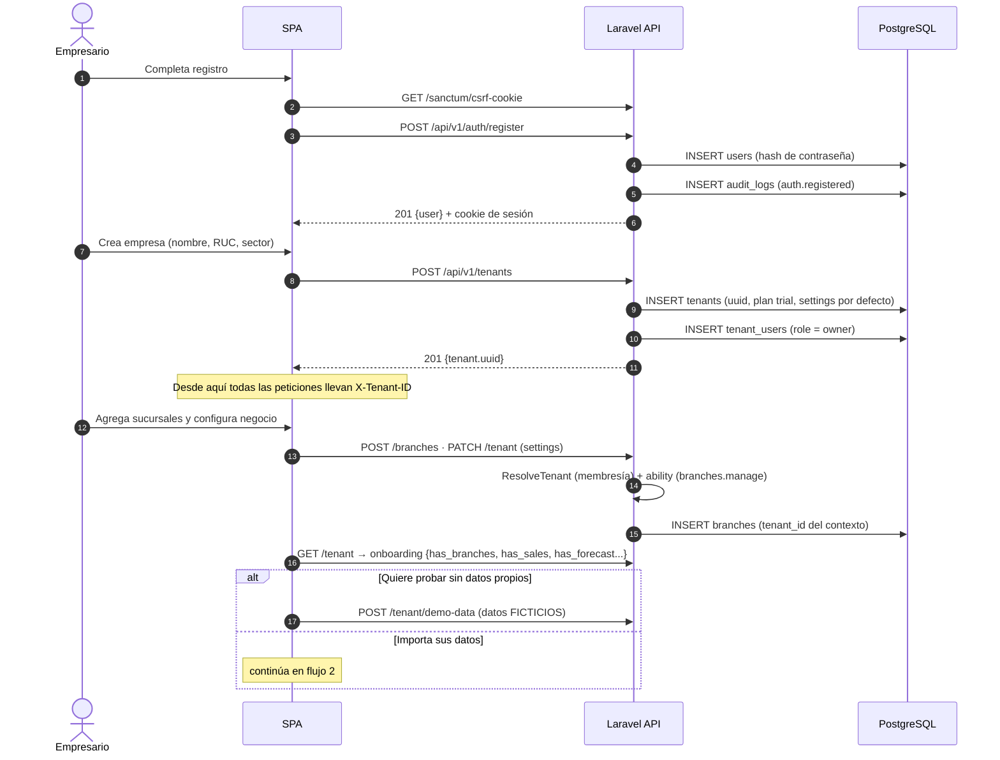
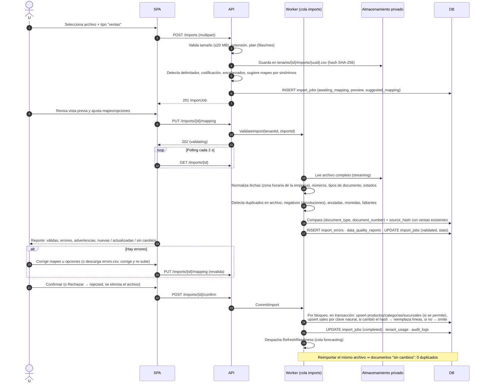
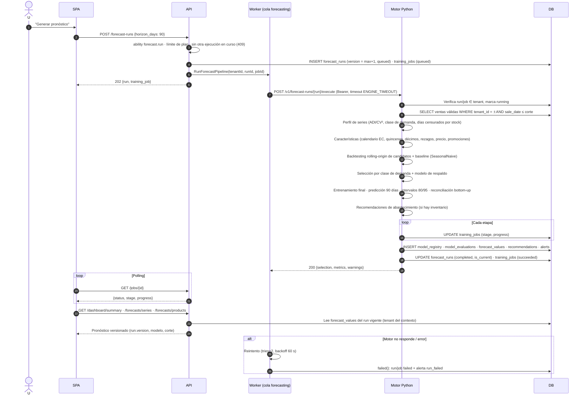
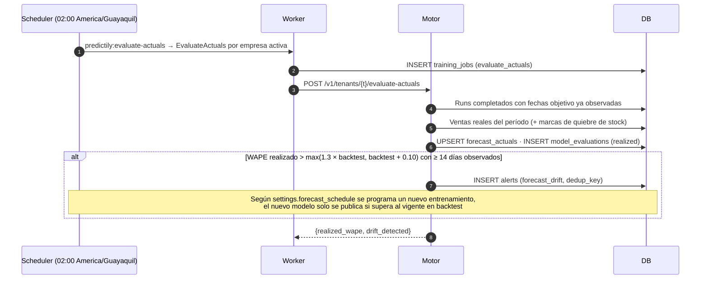
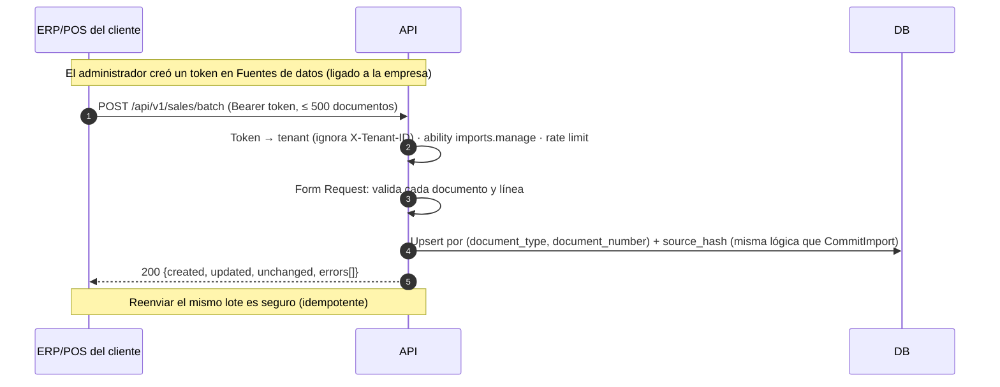
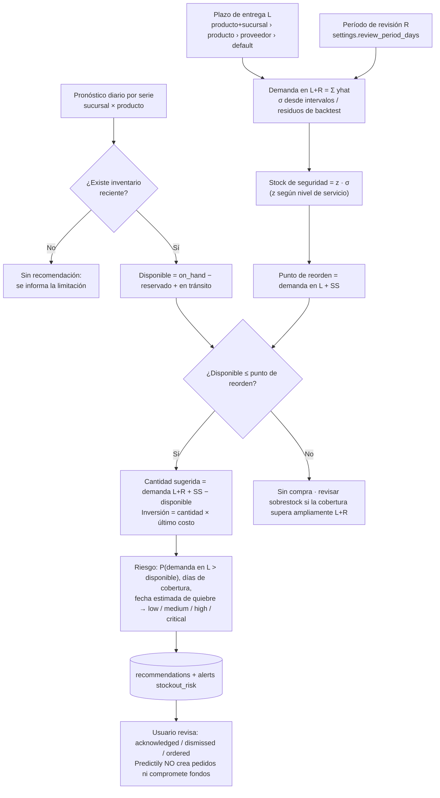
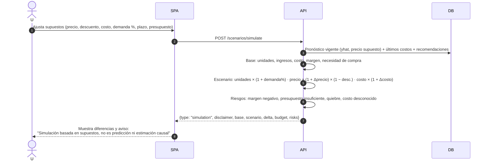
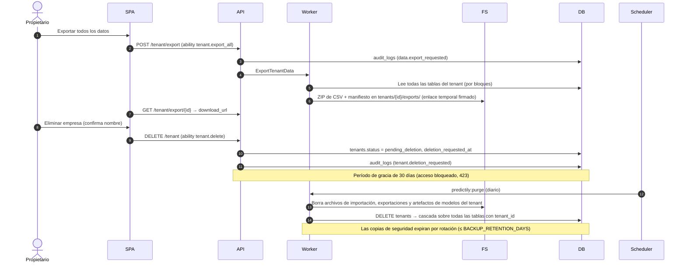

# 05 · Flujos principales

Diagramas de secuencia de los recorridos clave. Los nombres de endpoints, Jobs y estados
corresponden a `docs/06-contratos-integracion.md`.

Participantes: **U** = usuario (navegador), **SPA** = frontend Vue, **API** = Laravel,
**Q** = worker de cola Laravel (Redis), **ENG** = motor Python (FastAPI), **DB** = PostgreSQL,
**FS** = almacenamiento privado.

---

## 1. Registro → empresa → onboarding

## 2. Importación de ventas (CSV/Excel) con validación asíncrona e idempotencia

## 3. Ejecución de pronóstico (Laravel Job → motor → BD → frontend)

## 4. Evaluación diaria contra ventas reales y detección de deterioro (drift)

## 5. Ingesta por API REST (conector de sistemas de facturación)

Conectores sin API pública (sistemas locales): el contrato `Connector` permite implementaciones
que lean exportaciones programadas (CSV en carpeta/SFTP) o bases de datos de solo lectura. Hasta
contar con credenciales reales, el conector se muestra como `requires_credentials` / `planned`.

## 6. Recomendación de abastecimiento

## 7. Simulación de escenarios (determinista)

## 8. Exportación y eliminación de datos (LOPDP)

